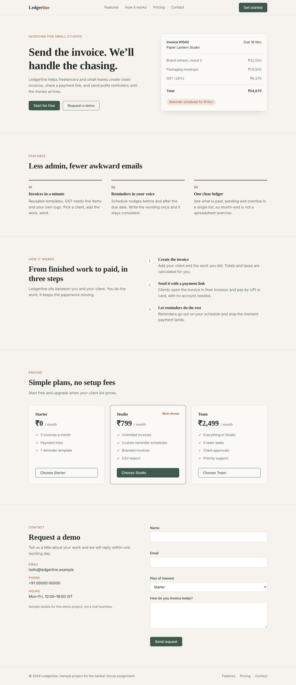
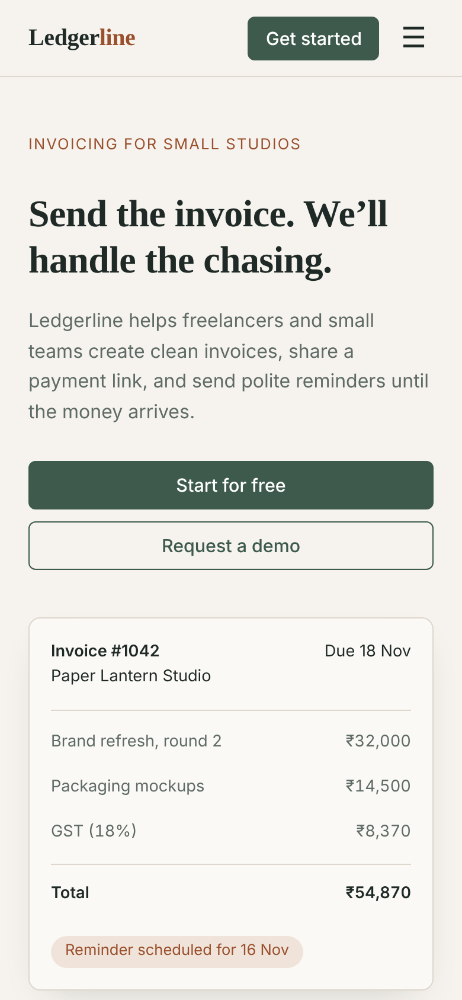

# Ledgerline

Responsive SaaS landing page for an invoicing tool for freelancers and small studios.

[Live demo](https://ayushrohilla0807-hash.github.io/ledgerline/)




## Features

- Sticky navigation with logo, section anchor links, and CTA button; collapses to a drawer menu on mobile viewports
- Hero section with headline, value proposition, primary/secondary CTAs, and a CSS-drawn invoice illustration
- Feature highlights, workflow breakdown, and tiered pricing grid
- Plan selection buttons that scroll to the contact form and automatically preselect the chosen tier
- Accessible contact form with real-time field validation, `aria-invalid`, `aria-describedby` error announcements, and mock submission state
- Mobile drawer navigation supporting outside click and Escape key dismissal
- Full Open Graph, Twitter card metadata, and inline SVG favicon

## Tech stack

- HTML5 (semantic structure)
- CSS3 (custom properties, CSS Grid, Flexbox, media query)
- Vanilla JavaScript (zero external dependencies or build tools)

## Run locally

No installation or build step is required. Open `index.html` directly in any modern browser, or start a local static server:

```bash
python3 -m http.server 8000
```

Then navigate to `http://localhost:8000`.

## Design notes

- Palette: Warm off-white (`#f6f3ee`), deep ink green (`#1f2a27`), and subtle clay accents (`#9a502d`).
- Typography: System serif (`"Iowan Old Style", Georgia, serif`) for editorial headlines and system sans-serif for clean body readability, loading with zero network overhead.
- Visual hierarchy: Content sections separated by hairline rules; card containers are reserved for pricing plan comparisons.
- CSS-rendered mockup: The invoice illustration is rendered purely in CSS, remaining crisp across device pixel ratios.
- Fixed header compensation: Handled via `scroll-padding-top: 72px` to prevent section titles from hiding under the fixed header.

## Accessibility

- Semantic landmark elements (`<header>`, `<nav>`, `<main>`, `<section>`, `<footer>`)
- High-contrast `:focus-visible` rings for keyboard navigation
- Form validation attributes (`required`, `aria-invalid`, `aria-describedby`) paired with accessible error messages
- Keyboard accessibility: mobile menu dismisses via the `Escape` key
- `prefers-reduced-motion` media query respects user preferences by disabling smooth scrolling and animations

## Project structure

```text
ledgerline/
├── index.html
├── README.md
├── LICENSE
├── .gitignore
└── screenshots/
    ├── desktop-contact-success.png
    ├── desktop-full.png
    ├── desktop-hero.png
    ├── mobile-hero.png
    ├── mobile-menu.png
    └── mobile-pricing.png
```

## License

MIT. See [LICENSE](LICENSE) for details.
